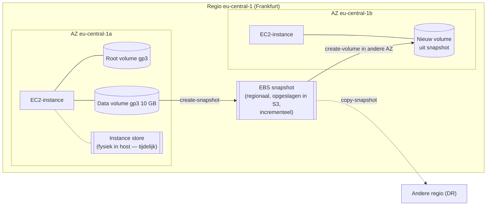

# Onderwerp 1 — Block storage en Amazon EBS

> Verhaallijn voor de presentatie (~15 min + 5 min vragen), opgebouwd uit `research.md`.
> Regio: **eu-central-1 (Frankfurt)**. Alles nog te controleren in de officiële AWS-docs (zie bronnen + checklist onderaan).

---

## Inhoudstafel (verhaallijn)

| # | Deel | Tijd | Kernvraag |
|---|------|------|-----------|
| 1 | Intro | 0:30 | Waarover gaat het? |
| 2 | Drie soorten storage | 2:30 | Block vs file vs object: wat, verschil, wanneer? |
| 3 | Amazon EBS in één beeld | 1:30 | Wat is EBS en hoe hangt het aan EC2 / AZ? (**eigen schema**) |
| 4 | Volumetypes | 3:00 | gp3, gp2, io2, st1, sc1 + prijs Frankfurt. Waarom gp3? |
| 5 | EBS-features | 2:30 | AZ-binding, snapshots, encryptie, vergroten |
| 6 | Instance store | 1:00 | Wat is het en wanneer ben je je data kwijt? |
| 7 | Live demo | 3:30 | gp3 koppelen → mkfs → mount → vergroten → snapshot |
| 8 | Kosten + opruimen | 0:30 | Wat kostte de demo? |
| 9 | Samenvatting + bronnen | 0:30 | 3 takeaways |

---

## 1. Intro

- AWS heeft 3 grote families storage: **block** (EBS), **file** (EFS/FSx), **object** (S3).
- Wij zijn de "experts" van **block storage → Amazon EBS**.
- Wat je na deze 15 min weet: wat block storage is, welk EBS-type je kiest, hoe je een volume beheert, en wanneer je data verliest.

---

## 2. Block vs file vs object storage

### Wat is block storage?
- Data wordt opgesplitst in **blokken van vaste grootte**, elk met een uniek adres.
- Minimale metadata → snel opzoeken.
- Het OS ziet een groep blokken als een **ruwe schijf** (volume) en zet er zelf een filesystem op (ext4, xfs, NTFS).
- Wijzig je een deel van een bestand → enkel de **gewijzigde blokken** worden herschreven → lage latency.

### Vergelijking

| Kenmerk | Block | File | Object |
|---|---|---|---|
| Structuur | Losse blokken, geen mappen | Hiërarchie (mappen) | Platte pool (bucket/key) |
| Metadata | Minimaal (adres) | Basis (naam, grootte, datum) | Uitgebreid, zelf te kiezen |
| Latency | Zeer laag | Laag–gemiddeld | Hoger |
| Aanpassen | Enkel gewijzigde blokken | Deel of heel bestand | Heel object opnieuw schrijven |
| Schaal | Gekoppeld aan 1 server | Goed, gedeeld | Vrijwel onbeperkt |
| Toegang | iSCSI / FC / NVMe (als schijf) | NFS / SMB | HTTP(S) REST API |
| AWS-dienst | **EBS**, instance store | EFS, FSx | S3 |

### Wanneer kies je wat? (keuzehulp)
- **Veel kleine lees/schrijfacties, max. snelheid, 1 server** → Block (databases, boot-schijf van VM, ERP, stateful containers).
- **Meerdere servers/mensen delen dezelfde mappen** → File (gedeelde schijf, webservers met gedeelde uploads, legacy apps).
- **Enorme hoeveelheid data, goedkoop, via HTTP** → Object (back-ups, media, data lakes, archief).

> Niet block kiezen als: meerdere servers tegelijk dezelfde bestanden moeten bewerken, of voor goedkope massa-opslag/archief.

---

## 3. Amazon EBS in één beeld — **eigen schema**

Idee voor het schema (zelf tekenen, bv. in draw.io / Excalidraw):



Boodschap van het schema:
- Een EBS-volume is een **netwerkschijf** in **één AZ**, alleen koppelbaar aan een EC2 in diezelfde AZ.
- Een **snapshot** is regionaal → zo verhuis je een volume naar een andere AZ of regio.
- **Instance store** zit fysiek in de host → geen netwerkschijf, verdwijnt mee.

---

## 4. EBS-volumetypes

### Overzicht (Frankfurt)

| | **gp3** | gp2 | io2 Block Express | st1 | sc1 |
|---|---|---|---|---|---|
| Type | SSD, general purpose | SSD, oudere generatie | SSD, provisioned IOPS | HDD, throughput | HDD, cold |
| Grootte | 1 GiB – 64 TiB | 1 GiB – 16 TiB | 4 GiB – 64 TiB | 125 GiB – 16 TiB | 125 GiB – 16 TiB |
| Max IOPS | 80.000 | 16.000 | 256.000 (Nitro) | 500 | 250 |
| Max throughput | 2.000 MiB/s | 128–250 MiB/s (250 vanaf 334 GiB) | 4.000 MiB/s | 500 MiB/s | 250 MiB/s |
| Baseline | 3.000 IOPS + 125 MiB/s (gratis) | 3 IOPS/GiB (min 100), < 1 TiB burst tot 3.000 via I/O credits | Alles zelf provisionen | 40 MiB/s per TiB (burst 250) | 12 MiB/s per TiB (burst 80) |
| Duurzaamheid | 99,8–99,9 % | 99,8–99,9 % | 99,999 % | 99,8–99,9 % | 99,8–99,9 % |
| Boot-volume | Ja | Ja | Ja | Nee | Nee |
| Prijs/GB-maand | **$0,095** | $0,119 | $0,149 | $0,054 | $0,018 |
| Extra prestaties | $0,006/IOPS > 3.000 · $0,0476 per MiB/s > 125 | inbegrepen | $0,078/IOPS (≤32k) · $0,0546 (32–64k) · $0,0382 (>64k) | inbegrepen | inbegrepen |

> Frankfurt is ±19 % duurder dan us-east-1 (gp3 daar $0,08).
> In het Howest-account zijn **io1/io2 geblokkeerd** en volumes max. **30 GB**.

### Waarom vandaag bijna altijd gp3?
1. **~20 % goedkoper** dan gp2 ($0,095 vs $0,119 per GB).
2. **Prestaties los van grootte**: 3.000 IOPS / 125 MiB/s gratis, ook op een schijf van 10 GB.
   - Voorbeeld: 100 GB DB die 3.000 IOPS nodig heeft → gp2: je moet 1.000 GB kopen (3 IOPS/GB) = ~$119/maand. gp3: 100 GB = ~$9,50/maand.
3. **Onafhankelijk schalen**: IOPS of throughput omhoog zonder extra GB.
4. **Geen burst credits**: constante prestaties (gp2 < 1 TiB kan "leeglopen").
5. **gp2 → gp3 live omzetten** via Elastic Volumes, zonder downtime.

### Wanneer dan wel iets anders?
- **io2 Block Express**: > 80.000 IOPS of > 2.000 MiB/s per volume, gemiddeld < 500 µs latency, 99,999 % duurzaamheid, **Multi-Attach** (1 volume aan meerdere instances).
- **st1**: grote sequentiële workloads (Kafka, logverwerking, data warehouse), TB's, MB/s belangrijk, IOPS niet.
- **sc1**: zelden gelezen data op een schijf aan de laagste prijs (vaak is S3 nog beter).
- **gp2**: enkel legacy; nooit voor nieuwe projecten.

---

## 5. EBS-features

### 5.1 Availability Zones
- Volume leeft in **één AZ** (bv. `eu-central-1a`), alleen koppelbaar aan EC2 in **dezelfde AZ**.
- Binnen die AZ automatisch gerepliceerd (beschermt tegen falen van één server, **niet** tegen uitval van de AZ).
- Andere AZ nodig? → **snapshot → nieuw volume in de andere AZ**.

### 5.2 Snapshots
- Point-in-time back-up, opgeslagen in **S3 (door AWS beheerd, niet zichtbaar als bucket)**.
- **Incrementeel**: eerste = volledig, daarna enkel gewijzigde blokken.
- Tussenliggende snapshot verwijderen is veilig: elke snapshot blijft volledig herstelbaar.
- **Regionaal** beschikbaar + kopieerbaar naar andere regio (disaster recovery).
- Prijs Frankfurt: $0,054 per GB-maand (standard) · $0,0135 (archive tier, min. 90 dagen).

### 5.3 Encryptie
- AES-256 met een data key uit **AWS KMS** (encryptie gebeurt in de Nitro-hardware), geen merkbaar prestatieverlies.
- Versleuteld: data at rest, data in transit tussen EC2 en volume, snapshots, en volumes gemaakt uit die snapshots.
- Bestaand onversleuteld volume? Niet rechtstreeks aan te zetten →
  1. snapshot nemen → 2. snapshot kopiëren met *Encrypt* (of versleuteld volume maken uit snapshot) → 3. nieuw volume koppelen.
- **Encryption by default** aanzetten per account **per regio** → elk nieuw volume automatisch versleuteld.

### 5.4 Volume vergroten (Elastic Volumes)
- Grootte, type, IOPS en throughput aanpassen **terwijl de instance draait**.
- **Verkleinen kan niet.**
- Volgende wijziging kan pas als de vorige `completed` is; max. **4 wijzigingen per 24 uur** per volume. De nieuwe grootte is al bruikbaar zodra de state `optimizing` is (meestal enkele seconden).
- Twee stappen:
  1. **AWS**: `modify-volume` → wacht tot state `optimizing` of `completed`.
  2. **OS**: partitie + filesystem uitbreiden:
     - met partitie: `growpart /dev/nvme0n1 1` + `resize2fs` (ext4) / `xfs_growfs` (xfs)
     - zonder partitie (zoals in onze demo): enkel `xfs_growfs <mountpoint>` of `resize2fs /dev/nvme1n1`
     - Windows: Disk Management → *Extend Volume*.

---

## 6. Instance store

- **Fysieke NVMe/HDD-schijven in de host** waarop je EC2 draait (ephemeral storage).
- Voordelen: extreem lage latency, hoge IOPS, inbegrepen in de prijs van bepaalde types (bv. `i3`, `d3`, `m5d`).
- **Data kwijt bij**:
  1. **Stop** van de instance (bij start → andere host)
  2. **Hibernate** (root moet EBS zijn; instance-store-data gaat verloren)
  3. **Terminate**
  4. **Falen van de onderliggende schijf** (geen replicatie)
  5. Ook: instance type wijzigen, instance retirement, shutdown vanuit het OS
- **Data blijft bij een reboot** (zelfde host).
- Gebruik voor: cache, buffers, scratch, tijdelijke data, of systemen die zelf repliceren (Cassandra, Hadoop).

| | EBS | Instance store |
|---|---|---|
| Locatie | Netwerkschijf in de AZ | Fysiek in de host |
| Blijft na stop | Ja | **Nee** |
| Snapshots | Ja | Nee |
| Losmaken / aan andere instance | Ja | Nee |
| Prijs | Per GB-maand | Inbegrepen in instance |

---

## 7. Live demo

> De demo draait nu via de Run-knoppen op de website (zie README). Demo-volumes zijn **niet** versleuteld: het Howest-account blokkeert KMS via een SCP.

**Doel**: extra gp3-volume (5 GB → 10 GB, opdracht: max. 10 GB) koppelen, filesystem, mount, vergroten zonder downtime, snapshot.
Infra (VPC/EC2) wordt op voorhand klaargezet met Terraform; de demo zelf doen we live met de CLI zodat het publiek elke stap ziet.

### Stap 0 — variabelen
```bash
export AWS_REGION=eu-central-1
INSTANCE_ID=i-xxxxxxxx
AZ=$(aws ec2 describe-instances --instance-ids $INSTANCE_ID \
  --query 'Reservations[0].Instances[0].Placement.AvailabilityZone' --output text)
```

### Stap 1 — gp3-volume maken (zelfde AZ!) en koppelen
```bash
VOL_ID=$(aws ec2 create-volume --availability-zone $AZ --size 5 --volume-type gp3 \
  --tag-specifications 'ResourceType=volume,Tags=[{Key=Name,Value=ebs-demo}]' \
  --query VolumeId --output text)
aws ec2 wait volume-available --volume-ids $VOL_ID
aws ec2 attach-volume --volume-id $VOL_ID --instance-id $INSTANCE_ID --device /dev/sdf
```

### Stap 2 — op de instance: filesystem + mount
```bash
lsblk                                   # Nitro: volume verschijnt als NVMe (bv. nvme1n1), niet sdf; volgorde niet gegarandeerd → check grootte
sudo mkfs -t xfs /dev/nvme1n1
sudo mkdir /data && sudo mount /dev/nvme1n1 /data
echo "hallo EBS" | sudo tee /data/test.txt
df -h /data                             # ~5G
```

### Stap 3 — vergroten zonder downtime
```bash
# lokaal / CloudShell
aws ec2 modify-volume --volume-id $VOL_ID --size 10
aws ec2 describe-volumes-modifications --volume-ids $VOL_ID \
  --query 'VolumesModifications[0].ModificationState'     # optimizing / completed

# op de instance (bestand blijft bereikbaar tijdens de hele operatie)
lsblk                                   # nvme1n1 = 10G
sudo xfs_growfs -d /data
df -h /data                             # ~10G
cat /data/test.txt                      # data nog steeds daar
```

### Stap 4 — snapshot
```bash
SNAP_ID=$(aws ec2 create-snapshot --volume-id $VOL_ID --description "ebs-demo" \
  --query SnapshotId --output text)
aws ec2 describe-snapshots --snapshot-ids $SNAP_ID --query 'Snapshots[0].[State,Progress,Encrypted]'
```

### Stap 5 — opruimen (verplicht!)
```bash
sudo umount /data                                     # op de instance
aws ec2 detach-volume --volume-id $VOL_ID
aws ec2 wait volume-available --volume-ids $VOL_ID
aws ec2 delete-volume --volume-id $VOL_ID
aws ec2 delete-snapshot --snapshot-id $SNAP_ID
# daarna: terraform destroy
```

> Output van elke stap bijhouden als tekst → **vraag 2** van de quiz.

---

## 8. Wat kost de demo? (prijsvoorbeeld Frankfurt)

| Resource | Berekening | Prijs |
|---|---|---|
| gp3 15 GB, 1 uur | 15 × $0,095 / 730 u | ≈ $0,002 |
| gp3 15 GB, hele maand | 15 × $0,095 | ≈ $1,43/maand |
| Snapshot (bijna leeg volume) | enkel gebruikte blokken × $0,054/GB-maand | < $0,01 |
| Zelfde 15 GB als gp2 | 15 × $0,119 | ≈ $1,79/maand (+25 %) |

Boodschap: storage blijft betalen tot je het verwijdert — EC2 wordt na 12 u gestopt, **volumes en snapshots niet**.

---

## 9. Samenvatting

1. **Block storage** = ruwe schijf, snelst, aan één server → EBS.
2. **Kies gp3**: goedkoper, 3.000 IOPS gratis, prestaties los van grootte.
3. EBS = **1 AZ**; **snapshots** maken het regionaal; **instance store** is weg na stop.

### Bronnen (laatste slide — allemaal nog openen en controleren)
- Amazon EBS volume types — https://docs.aws.amazon.com/ebs/latest/userguide/ebs-volume-types.html
- General Purpose SSD (gp2/gp3) — https://docs.aws.amazon.com/ebs/latest/userguide/general-purpose.html
- Provisioned IOPS SSD (io2) — https://docs.aws.amazon.com/ebs/latest/userguide/provisioned-iops.html
- Throughput Optimized / Cold HDD — https://docs.aws.amazon.com/ebs/latest/userguide/hdd-vols.html
- Amazon EBS snapshots — https://docs.aws.amazon.com/ebs/latest/userguide/ebs-snapshots.html
- Amazon EBS encryption — https://docs.aws.amazon.com/ebs/latest/userguide/ebs-encryption.html
- Modify a volume (Elastic Volumes) — https://docs.aws.amazon.com/ebs/latest/userguide/ebs-modify-volume.html
- Extend the file system — https://docs.aws.amazon.com/ebs/latest/userguide/recognize-expanded-volume-linux.html
- Make a volume available for use — https://docs.aws.amazon.com/ebs/latest/userguide/ebs-using-volumes.html
- Instance store — https://docs.aws.amazon.com/AWSEC2/latest/UserGuide/InstanceStorage.html
- Instance store lifetime — https://docs.aws.amazon.com/AWSEC2/latest/UserGuide/instance-store-lifetime.html
- EBS NVMe — https://docs.aws.amazon.com/ebs/latest/userguide/nvme-ebs-volumes.html
- Prijzen: AWS Price List API, EU (Frankfurt), opgevraagd 23/11/2026
- Block vs file vs object — https://aws.amazon.com/compare/the-difference-between-block-file-object-storage/
- EBS pricing — https://aws.amazon.com/ebs/pricing/ (regio Frankfurt selecteren)

---

## Factcheck (23/11/2026)

- ✅ Volumelimieten gp3/gp2/io2/st1/sc1 — AWS docs (ebs-volume-types, general-purpose, provisioned-iops, hdd-vols).
- ✅ Alle Frankfurt-prijzen — AWS Price List API (`aws pricing get-products`, location *EU (Frankfurt)*).
- ✅ Encryptie AES-256/KMS, per-regio default, niet rechtstreeks bestaand volume versleutelen — ebs-encryption, how-ebs-encryption-works.
- ✅ Snapshots incrementeel, regionaal, S3, tussenliggende verwijderen veilig — ebs-snapshots.
- ✅ Instance store lifetime — instance-store-lifetime.
- ✅ NVMe-naamgeving + `xfs_growfs -d <mountpoint>` — nvme-ebs-volumes, recognize-expanded-volume-linux.
- ❌ Gecorrigeerd: "6 uur wachten tussen wijzigingen" → eigenlijk: vorige moet `completed` zijn, max 4 per 24u.
- ❌ Gecorrigeerd: gp2 throughput 128–250 MiB/s; io2 256k IOPS enkel op Nitro; gp3 throughput $0,0476.
- ⚠️ research.md bevat nog de oude (foutieve) claims — gebruik deze file als waarheid.

## Open voor later (niet in deze file)
- Website-structuur (de presentatie = site op AWS), Terraform + Ansible setup.
- Examenvragen (vraag 3) → zelf schrijven zonder AI.
